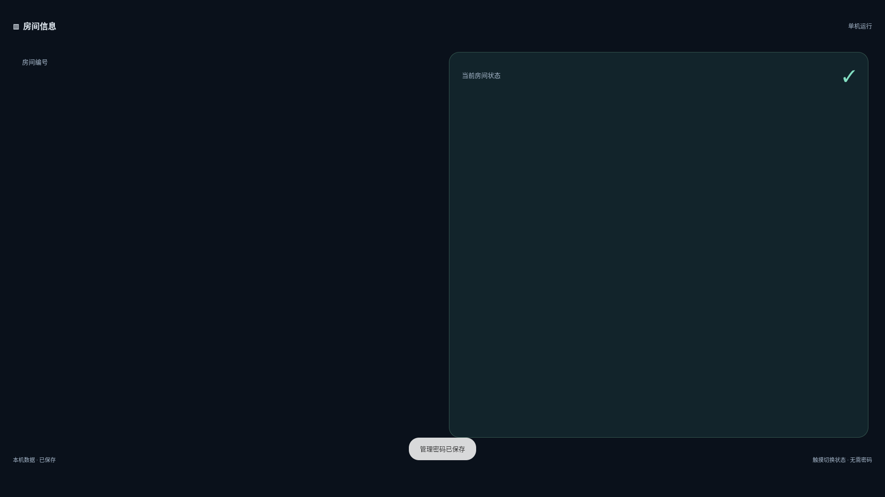
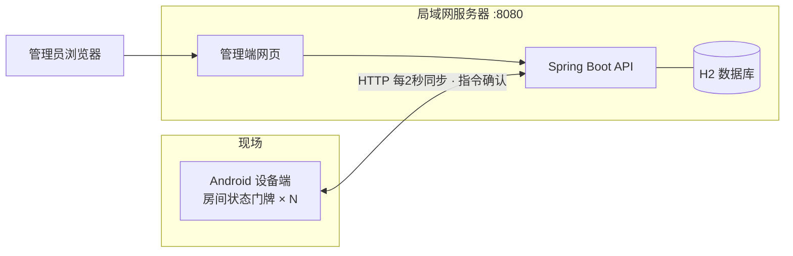
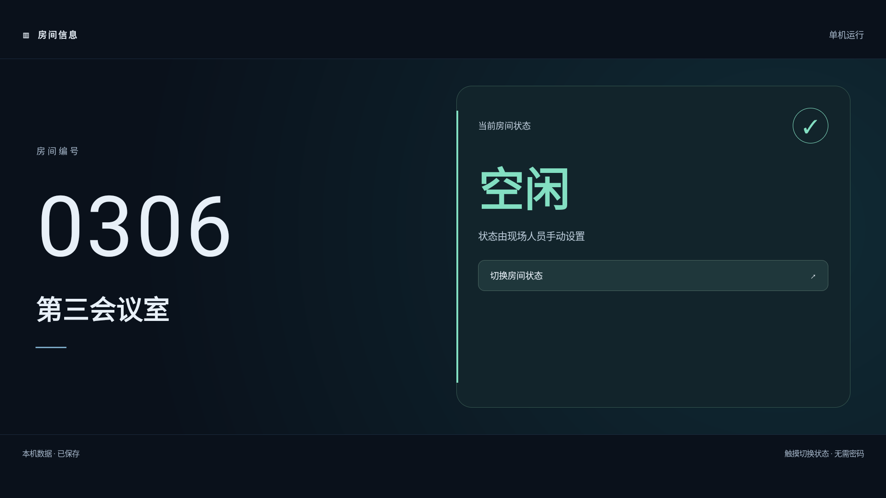

# 房间状态显示系统（Room Display）

面向会议室/房间门口的**状态显示门牌**：现场人员免密码一键切换房间状态，管理端集中管理 20–30 台及以上设备。三端均可离线构建、无外部 CDN 依赖，适合受信局域网内独立部署。

- **Android 设备端**（Kotlin 原生）：横竖屏状态展示、本地编辑、状态免密切换、管理密码、持续亮屏、可选专用设备锁定（防退出）
- **局域网服务端**（Java 17 构建 / Java 8 可运行 · Spring Boot · H2）：设备注册与同步、指令下发与确认、状态模板、操作日志；**单个 JAR 内嵌管理端网页**
- **浏览器管理端**（Vue 3 · Vite）：真实设备列表、房间与状态模板管理、批量下发、操作日志、密码与设备接入管理



## 功能特性

**设备端**
- 大字号房间编号/名称与状态卡，横竖屏可切换，适配不同分辨率与密度的屏幕
- 状态切换免密码；房间信息、状态配置、服务器连接等受管理密码保护（长按房间名称 2 秒进入）
- 本地优先：断网可独立编辑与展示，联网后自动同步；每次修改先持久化再上传
- 持续亮屏、沉浸式全屏、应用内退出需密码；可选专用设备锁定拦截系统主页/多任务/通知栏/电源菜单

**服务端**
- 管理员认证（BCrypt、会话 12 小时、按 IP 限制失败尝试）、修改密码
- 设备注册（注册密钥换取设备凭据，凭据只存摘要）、每 2 秒同步、指令下发与确认
- 状态模板管理与批量下发、操作日志查询；H2 文件数据库，重启不丢数据

**管理端**
- 登录后查看真实注册设备（在线/离线、版本、待确认指令），无演示假数据
- 房间/状态编辑与切换均带版本号，设备确认保存后才显示"已生效"
- 模板保存与下发分离；离线或有待确认指令的设备不可选；日志逐台记录结果

## 系统架构



- 跨端接口与同步约定见 [API-CONTRACT.md](API-CONTRACT.md)
- 设备每 2 秒同步一次；15 秒无心跳视为离线，指令 15 秒过期；revision 单调递增，ack 幂等去重
- 后台操作必须等设备确认保存后才标记已生效；离线或已有待确认指令时拒绝新指令
- 同一局域网应保持服务器与设备时间正确（设备校验指令过期时间）

## 目录结构

```
room-display/
├── android/          # Kotlin 原生 Android 应用（Gradle 工程）
├── server/           # Spring Boot 服务（内嵌 Vue 管理端，单 JAR 交付）
│   ├── src/          # Java 服务源码、H2 schema、集成测试
│   └── web/          # Vue3 管理端源码（构建产物并入 JAR 的 static）
├── deploy/           # Windows/Linux 启动脚本、room.env 示例、systemd 示例
├── docs/             # 设计说明与模拟器验证截图
├── tests/            # 跨端协议联调测试（独立测试服务器用）
└── API-CONTRACT.md   # 三端接口契约
```

## 快速开始

### 构建要求
- **服务端**：JDK 17 + Maven 3.9（构建用；产物为 Java 8 字节码，Java 8 及以上可运行）。管理端无需预装 Node——Maven 构建会自动下载 Node 并构建网页（首次需联网）
- **Android**：Android SDK Platform 35 / Build Tools 35.0.0

```sh
cd server
mvn clean package          # 前端依赖安装 + 单测 + 网页构建 + Java 测试 + 打包
cd ../android
# 设置 ANDROID_HOME，或在 local.properties 配置 sdk.dir
./gradlew assembleDebug    # Windows 用 gradlew.bat
```

产物：
- `server/target/room-server-1.0.0.jar` —— 含管理端网页的完整服务
- `android/app/build/outputs/apk/debug/app-debug.apk` —— 设备端调试包

### 启动服务

把 JAR 复制为部署目录下的 `room-server.jar`（deploy/ 脚本按此名启动），配置两个必填环境变量：

| 环境变量 | 说明 |
|---|---|
| `ROOM_ADMIN_PASSWORD` | 首次建库的管理员初始密码，≥8 字符且 UTF-8 不超过 72 字节 |
| `ROOM_ENROLLMENT_KEY` | 设备注册密钥，≥12 字符，建议 32 位以上随机串 |
| `PORT` | 可选，默认 8080 |

Linux（deploy/ 目录下）：

```sh
cp room.env.example room.env   # 编辑填入强密码与随机注册密钥
chmod 600 room.env && chmod +x start-linux.sh
./start-linux.sh
```

Windows（deploy/ 目录下 PowerShell）：

```powershell
$env:ROOM_ADMIN_PASSWORD='请替换为强密码'
$env:ROOM_ENROLLMENT_KEY='请替换为足够长的随机设备注册密钥'
.\start-windows.ps1
```

浏览器访问 `http://服务器IP:8080`，初始用户名 `admin`。首次建库后请在后台修改管理员密码；注册密钥可在后台「系统设置 · 设备接入」查看与更换。H2 数据库位于启动工作目录的 `data/` 下——**不要**多进程共用同一 data 目录；备份前先正常停止服务再复制整个 data 目录。防火墙按需放行 8080，脚本不自动改防火墙。`room-display.service` 仅为可选 systemd 示例，使用前请创建专用非 root 用户并按实际路径修改。

### Android 设备接入

1. 安装 APK，首次启动设置本机管理密码（≥6 位，无内置默认密码）
2. 长按房间名称 2 秒进入「本机设置」：可先完全离线地编辑房间号/名称/状态
3. 勾选「连接服务器」→ 填 `http://服务器局域网IP:8080`（官方模拟器访问宿主机用 `http://10.0.2.2:8080`）→ 保存
4. 「注册 / 查看连接」→ 输入 `ROOM_ENROLLMENT_KEY` →「注册并连接」；成功后管理端自动出现该设备

设备本地管理密码、后台 admin 密码、设备注册密钥**用途不同、互不通用**。注册密钥只用于首次注册，返回的设备凭据保存在应用私有存储；更换服务器或清除应用数据会产生新设备身份，后台保留旧记录以供审计。

## 防退出与持续亮屏

- 前台持续亮屏、沉浸式显示、应用内退出需密码——已默认开启（经模拟器验证：系统休眠 15 秒下屏幕保持点亮）
- **系统级防退出**（拦截系统主页、多任务、通知栏、电源菜单）通过「设备所有者 + LockTask」实现，需部署人员授权后在本机设置启用：

```sh
adb shell dpm set-device-owner com.roomdisplay.app/.RoomAdminReceiver
```

设备须无任何账号（真机通常需恢复出厂的专用设备）。随后在「本机设置」勾选「启用专用设备锁定」并保存。锁定仅保留系统信息（时钟/电量），应用回到前台自动恢复锁定，管理员凭密码经「退出应用」退出。官方模拟器（Android 11）已验证拦截有效：



## 安全说明

- HTTP 仅适用于**受信局域网**；跨不可信网络请使用 HTTPS 反向代理与可信证书，APK 不跳过证书校验
- 交付 APK 为调试签名，仅供联调；正式分发请用组织自己的 release 签名密钥构建并长期保管
- 仓库不含 SDK、JDK、node_modules、签名密钥与任何测试账户/凭据
- 管理员密码 BCrypt 存储、设备凭据只存 SHA-256 摘要、本机密码 PBKDF2 加盐存储

## 测试

```sh
cd server && mvn test          # Java 接口集成测试（内存 H2，8 项：认证/注册/冲突/过期/幂等/模板）
cd server/web && npm test      # 管理端模型单测（也可经 mvn 一并执行）
python tests/protocol-integration.py   # 协议联调：30 设备并发同步/离线重连/冲突（仅对独立测试服务器）
```

另有浏览器真实联调与模拟器验收记录：30 台设备并发同步、指令确认、离线重连、服务重启持久化均通过；设备端在官方模拟器完成安装、注册、设置与防退出验证（截图见 docs/）。

## 生产部署清单

1. 设备恢复出厂、**不登录任何账号**，联网并启用自动校时，开启 USB 调试
2. 用正式签名构建 release APK 并安装
3. `adb shell dpm set-device-owner com.roomdisplay.app/.RoomAdminReceiver` 授予设备所有者
4. 设置本机管理密码 → 配置房间信息/状态 → 连接服务器 → 输入注册密钥注册
5. 勾选「启用专用设备锁定」→ 保存，验收：Home/多任务/通知栏/电源菜单均无法退出，状态切换与后台下发正常
6. 断电恢复后需手动打开应用，或使用面板自带的"上电自启/开机启动"设置（应用本身不含开机自启）

## 已知边界

- 实际 13.3 英寸设备的厂家固件（Android 版本、显示密度、设备所有者/LockTask 支持）需实机验证；模拟器验证通过不等同于真机验收
- 电源键手动锁屏属硬件行为，软件无法禁止
- 当前版本不提供设备删除/凭据恢复界面；清除应用数据即重新注册为新设备
